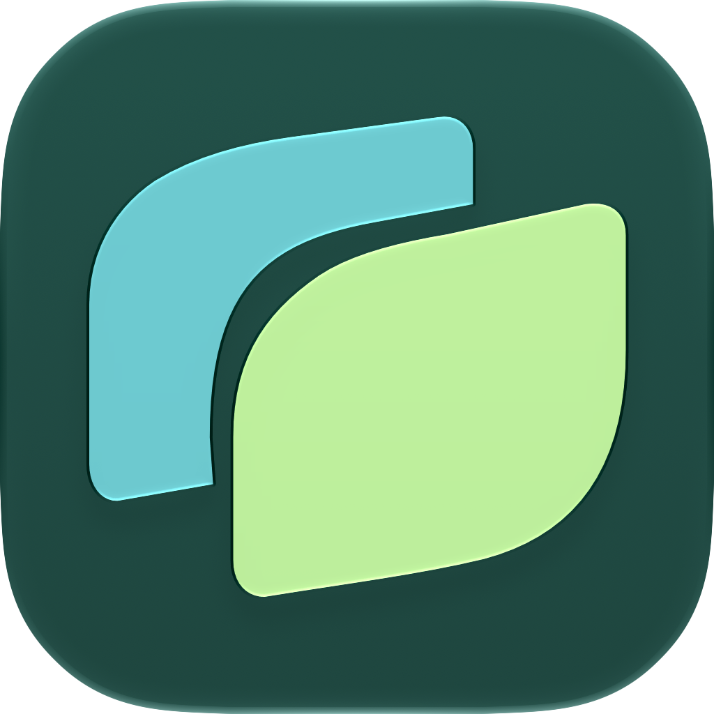
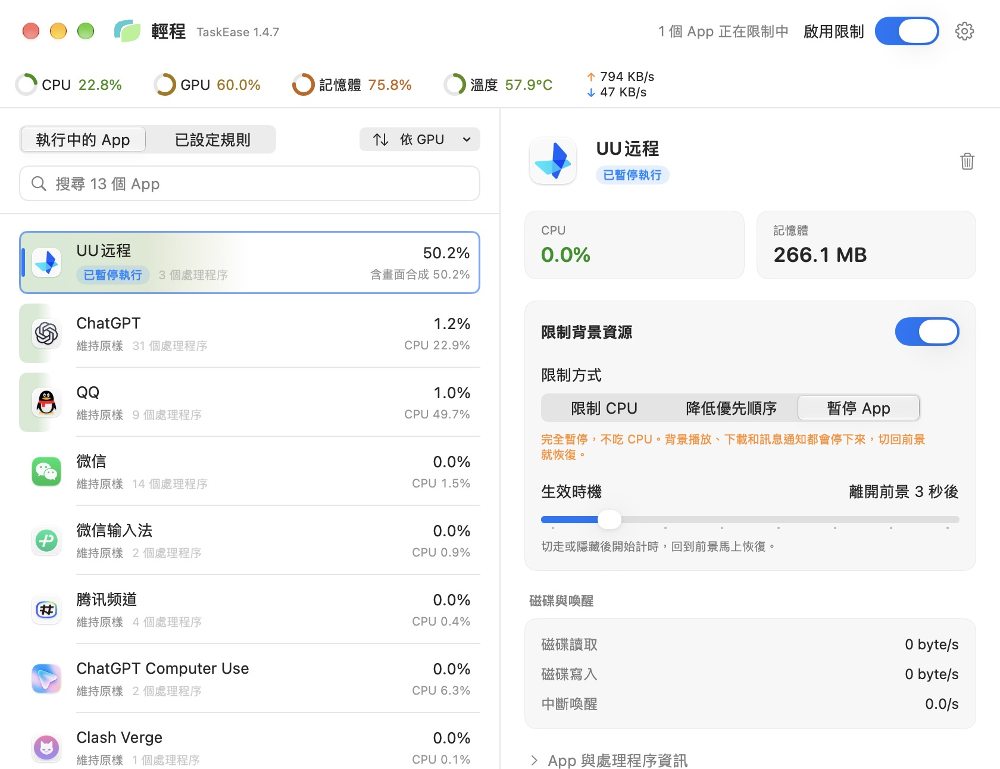
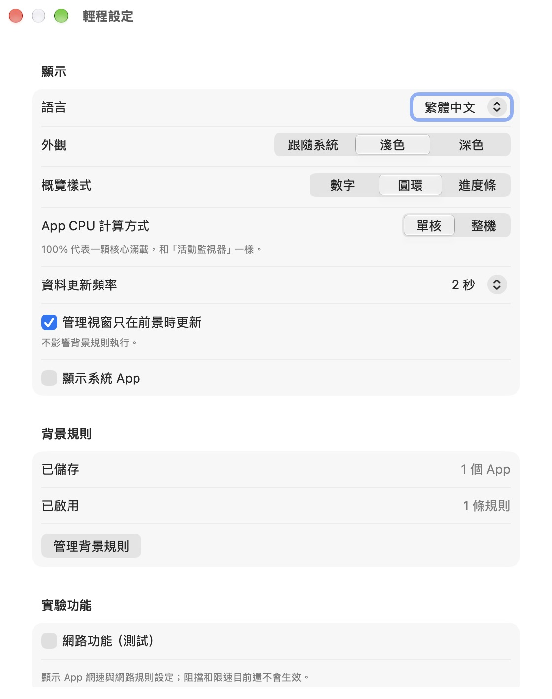
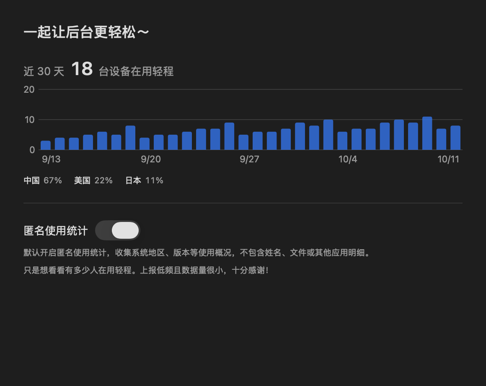

<p align="center">
  
</p>

<h1 align="center">TaskEase · 轻程</h1>

<p align="center">找出拖慢 Mac 的后台应用，切走几秒后自动限制或暂停，切回来立即恢复。</p>

<p align="center">叠层双叶呈现前后台任务，菜单栏使用随系统外观变化的单色标识。</p>

<p align="center">
  
  
  
  
  <a href="LICENSE"></a>
</p>

<p align="center">
  <a href="#为什么做轻程">为什么做轻程</a> ·
  <a href="#功能">功能</a> ·
  <a href="#开始使用">开始使用</a> ·
  <a href="#常见问题">常见问题</a> ·
  <a href="#开发">开发</a> ·
  <a href="#更新计划">更新计划</a> ·
  <a href="Docs/Usage.md">使用说明</a>
</p>



截图来自轻程 1.4.7 的实际运行界面，使用繁体中文与浅色外观，应用占用为截图时的数据。

<details>
<summary>设置与使用统计</summary>

<table><tr><td valign="top"></td><td valign="top"></td></tr></table>

</details>

## 为什么做轻程

起因是一台没有风扇的 MacBook Air。用 UU 远程连上一台 Windows 电脑后，Mac 很快变得烫手，烫了就频繁降频，降频又让同样的工作耗更多电。打开活动监视器，CPU 占用却看不出任何异常。

排查下来，问题出在 UU 远程：远程画面在后台持续解码、持续合成，GPU 一直被占着，而这部分开销记在系统进程 WindowServer 名下，不会算到 UU 头上。

我不想用完就关掉 UU，否则下次还得重新连接；只希望它在我切走以后安静下来。最初想限制它的帧率，但 macOS 没有可靠的办法从外部限制别的应用的帧率。于是换个思路：应用离开前台几秒后，限制它的 CPU，或者干脆暂停，回到前台立即恢复。这就是轻程。

## 使用效果

以 UU 远程为例：给它设置“离开前台 3 秒后暂停应用”。切到别的窗口 3 秒后 UU 停止运行，Mac 不再发烫；远程连接不会断开，切回来时画面转几秒圈就恢复，比重新连接快得多。

同样的方法适用于在后台仍然占资源的应用：网页、聊天客户端、开发工具、各类同步和下载工具。对于只需要“少占一点”的应用，可以改成限制 CPU 或降低优先级，而不是完全暂停。

## 功能

**看清是谁在占用**

- 运行中的应用连同它的辅助进程一起统计 CPU、内存、GPU、磁盘读写和中断唤醒，可按任意一项排序；搜索不分繁简，也认英文名。
- 选中应用可以看到当前排序指标最近 3 分钟的折线图。
- 顶部概览显示整机 CPU、GPU、内存、芯片温度和网速；指针移上去查看芯片型号、核心数、内存构成等详情。
- GPU 详情列出主要使用者，包括系统进程 WindowServer。正在显示视频画面的应用（远程桌面、播放器等）会让 WindowServer 持续合成屏幕，这部分开销会估算后算回对应应用，不再出现“整机 GPU 70%，却找不到是谁”的情况。

**按前后台自动限制**

- 每个应用单独设置规则，可以组合：性能限制（CPU 上限，例如 20%，拖到最左即暂停）、后台音量（可调低或静音）、降低优先级。
- 生效时机可选离开前台后 1 秒到 5 分钟，也可以设为始终限制（暂停方式除外）；回到前台立即恢复。
- 一个总开关控制全部规则；规则在应用退出后仍保留，下次启动自动匹配。
- 睡眠、退出或控制进程意外终止时，被限制的应用都会被恢复，不会一直卡在暂停状态。

**轻量，不打扰**

- 常驻菜单栏，面板里能看到占用最高的应用和整机概览。
- 窗口不可见时停止界面采样，后台规则单独按需检查，本身的开销很低。
- 界面支持 English、简体中文和繁體中文，可在设置中直接切换；支持浅色、深色和跟随系统。
- 启动时检查新版本，有更新时在标题旁显示提示，一键下载、校验并替换。

**网络（实验功能）**

默认关闭。开启后显示每个应用的网速，并可以保存阻断和限速规则。由于缺少开发者账号签名，这些网络规则目前只保存、不执行。

## 开始使用

在终端运行这一行，会下载最新版、校验后安装到“应用程序”，首次打开不会被系统拦截：

```sh
curl -fsSL https://raw.githubusercontent.com/polang233/TaskEase/main/Scripts/install.sh | sh
```

安装包放在临时目录，装完自动删除；再次运行即可更新。也可以从 [Releases](https://github.com/polang233/TaskEase/releases/latest) 下载 DMG 拖到“应用程序”，这种方式第一次打开会提示“移到废纸篓”（轻程暂未经过 Apple 公证）：点“完成”，再到“系统设置 → 隐私与安全性”底部点“仍要打开”，只需一次。

装好后：选中想限制的应用，打开“限制后台资源”，选好生效时机和限制方式，再打开顶部的“启用限制”。更详细的操作见 [使用说明](Docs/Usage.md)。

## 常见问题

**暂停应用会影响什么？**
暂停期间应用完全停止：后台播放、下载和消息通知都会停下来，网络连接可能因为心跳中断而断开。UU 远程实测不会断开，切回来时需要几秒重新同步画面。需要在后台继续工作的应用，建议用“降低优先级”或“限制 CPU”；限制 CPU 的原理是按上限短暂暂停，同样可能影响声音和连接心跳。

**为什么不直接限制帧率？**
macOS 没有从外部限制其他应用渲染帧率的公开机制。轻程改为按前后台状态控制整个应用，效果更直接，也适用于所有应用。

**CPU 百分比怎么算？**
应用 CPU 默认按单核计算，100% 约等于一个核心满载，与活动监视器一致；也可以在设置里改成按整机计算。顶部 CPU 是全部核心的总体占用。各项指标的口径和局限见 [系统指标](Docs/SystemMetrics.md)。

**需要什么权限？**
不需要辅助功能或屏幕录制权限。轻程以当前用户身份读取和控制进程，只能控制当前用户自己的应用，无法控制系统进程。

## 使用统计

[](https://us.posthog.com/shared/Do9W3574hr41SnipsKsuPGuWM_LYrw)

统计图每 6 小时从公开看板自动生成。轻程默认开启匿名使用统计，只上报版本、系统地区等概况，可在“关于轻程 → 使用统计”关闭；字段说明见 [PostHog 文档](Docs/PostHog.md)。

## 开发

需要 Apple Silicon Mac、macOS 14 及以上和 Xcode 27。工程使用 Swift 6、SwiftUI、AppKit 和 Observation。

用 Xcode 打开 `TaskEase.xcodeproj`，选择 **TaskEase / My Mac**。按 Command-R 开发运行，按 Command-U 运行自动测试。

在项目根目录生成本机 Release 应用：

```sh
sh Scripts/build-app.sh
```

输出为 `build/TaskEase.app`；`sh Scripts/build-dmg.sh` 再生成 `build/TaskEase-版本.dmg`。发布时标签写成 `v版本号` 并上传这个 DMG，应用内更新和一行安装命令都依赖它和 GitHub 提供的 SHA-256 摘要。

应用以当前用户身份读取和控制进程，应用目标关闭 App Sandbox。只有正在执行后台规则时才启动同用户控制进程，退出、失联和异常终止有恢复机制。

## 项目结构

```text
TaskEase/
  App/                       应用入口、状态与窗口生命周期
  Features/
    Applications/            应用列表与管理窗口
    Rules/                   规则编辑与执行策略
    Networking/              网络规则编辑
    MenuBar/                 菜单栏面板
    Settings/                显示与外观设置
    Help/                    使用帮助
    About/                   关于信息、使用统计与许可证
  Models/                    规则、进程身份与采样数据
  Services/
    Monitoring/              异步采样与采样周期
    Networking/              网络快照与速度计算
    ProcessControl/          原生控制、独立控制进程与恢复
    Storage/                 本地应用数据管理
  Shared/                    共用视图与数值格式
  Resources/                 图标、图片资源与许可证
  Validation/                只读快照与自建负载自检
TaskEaseTests/               单元与窗口生命周期测试
TaskEaseUITests/             界面交互测试
Docs/                       需求、设计、使用和验证文档
Scripts/                    构建、自检与只读开销测量
Branding/                   Logo 源文件与制作说明
Experiments/                独立能力实验，不进入应用包
Artifacts/                  验证摘要和界面预览
```

目录与 Xcode 项目导航保持同步。模块职责和数据流见 [设计文档](Docs/Design.md)。

## 更新计划

已完成的功能见上方介绍和 [发布记录](https://github.com/polang233/TaskEase/releases)。接下来：

- [ ] 更多系统指标与更长时间的历史趋势。
- [ ] 更多 Apple Silicon 机型的温度传感器覆盖验证。
- [ ] 完成网络扩展签名与部署，实现应用级阻断和上下行限速。
- [ ] 针对支持应用研究后台帧率和视频处理节奏适配。
- [ ] 实际应用的耗电、温度和限制效果对比。
- [ ] 发布签名与公证。
- [ ] Windows 版本，设计见 [Windows/README.md](Windows/README.md)。

## 验证与贡献

进程控制自检只使用自己创建的限时负载进程。可复跑的命令、测量结果和使用边界见 [验证文档](Docs/Validation.md)。

修改规则或进程控制时，请覆盖前台恢复、应用重启和异常退出场景。提交性能问题时，记录系统版本、芯片、应用前后台状态和采样结果，避免仅凭机身温度判断占用来源。

- [网络监控与规则设计](Docs/Networking.md)
- [系统概览指标与温度读取](Docs/SystemMetrics.md)
- [需求与验收条件](Docs/Requirements.md)
- [设计与恢复机制](Docs/Design.md)
- [使用说明](Docs/Usage.md)
- [验证方法与结果](Docs/Validation.md)
- [数据位置与使用统计](Docs/DataAndPrivacy.md)
- [PostHog 配置与维护](Docs/PostHog.md)
- [多语言与翻译贡献](Docs/Localization.md)
- [图标设计与资源](Branding/README.md)

本项目采用 [GNU GPLv3](LICENSE)，SPDX 标识为 `GPL-3.0-only`。

<p align="center">觉得轻程有用的话，欢迎点个 Star 🌟</p>
