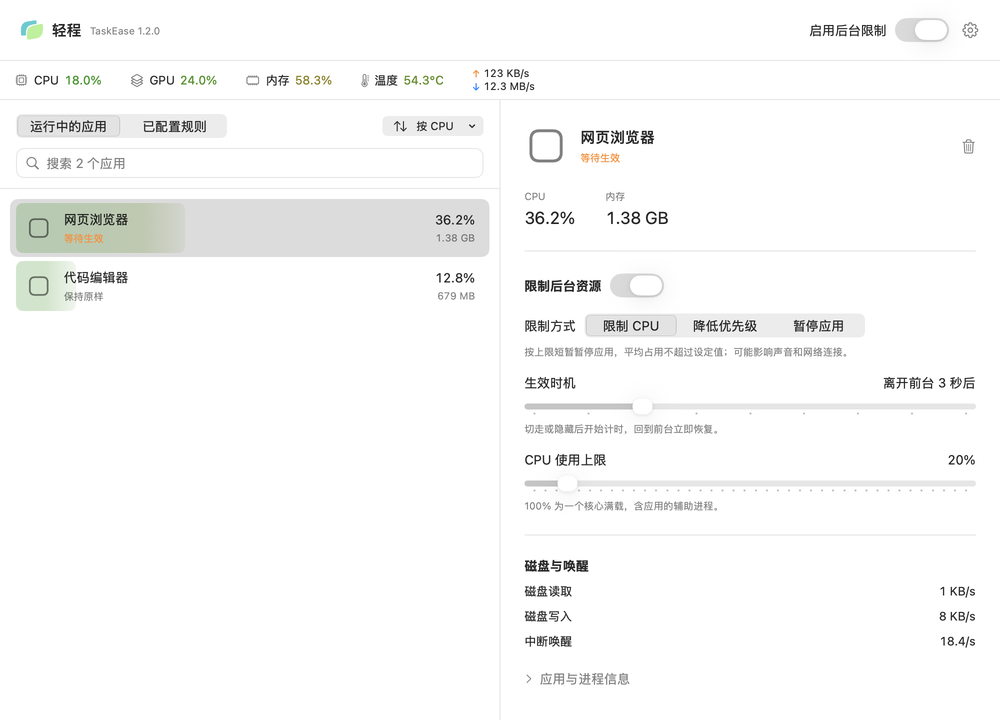
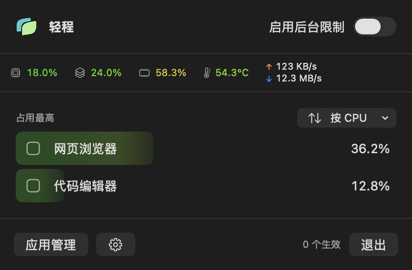
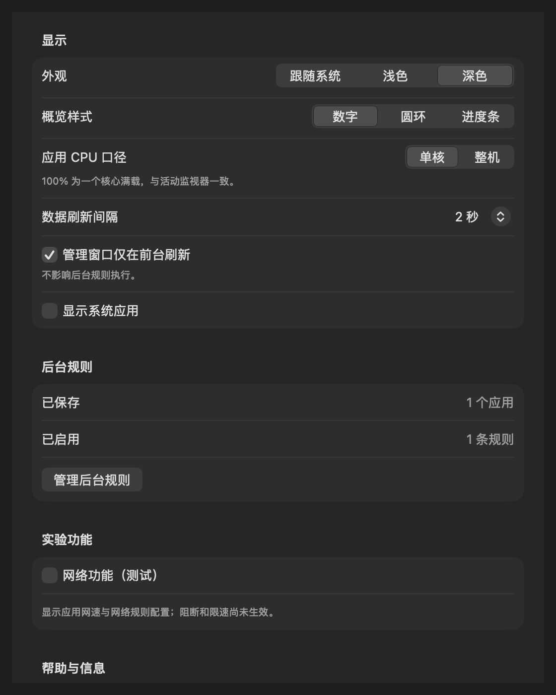
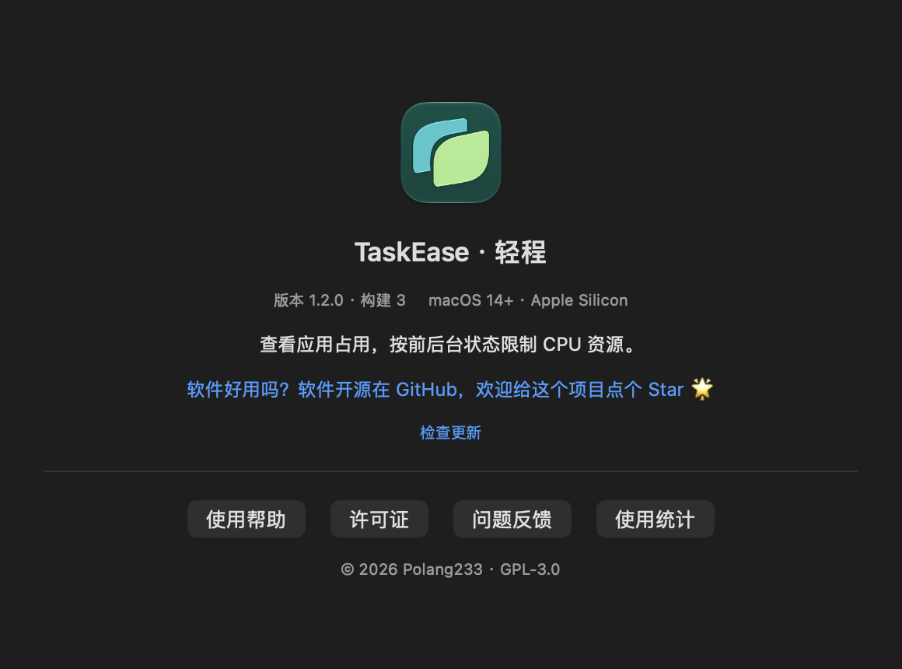

<p align="center">
  
</p>

<h1 align="center">TaskEase · 轻程</h1>

<p align="center">查看应用占用，按前后台状态限制 CPU 资源。</p>

<p align="center">叠层双叶呈现前后台任务，菜单栏使用随系统外观变化的单色标识。</p>

<p align="center">
  
  
  
  
  <a href="LICENSE"></a>
</p>

<p align="center">
  <a href="#功能">功能</a> ·
  <a href="#开始使用">开始使用</a> ·
  <a href="#开发">开发</a> ·
  <a href="#使用统计">使用统计</a> ·
  <a href="#更新计划">更新计划</a> ·
  <a href="Docs/Usage.md">使用说明</a>
</p>



界面示例由实际视图与预览数据渲染。

<details>
<summary>菜单栏与设置</summary>

<table><tr><td></td><td></td></tr></table>

<table><tr><td></td><td></td></tr></table>

</details>

## 功能

| 功能 | 内容 |
| --- | --- |
| 应用占用 | 合计应用及其自有辅助进程的 CPU、物理内存、磁盘活动和中断唤醒 |
| 网络实验 | 默认关闭；开启后显示应用网络速度与测试规则 |
| 网络规则配置 | 保存阻断、限速和作用时间参数；测试功能暂缺开发者账号签名，尚未执行控制 |
| 系统概览 | 整机 CPU、GPU、内存占比、上传/下载速度和芯片温度；点击查看芯片型号、核心数等详情，可切换数字、圆环或进度条样式 |
| 后台限制 | 离开前台后按预设档位等待，再限制 CPU、降低优先级或暂停应用，回到前台恢复；也可设为始终限制 |
| 规则列表 | 单独查看已配置规则，应用退出后仍可编辑 |
| 应用列表 | 搜索，按 CPU、内存、GPU、磁盘、网络或名称排序；默认展示用户应用，可开启系统应用显示 |
| 设置与窗口 | 深浅外观、显示刷新间隔、应用 CPU 口径、帮助、关于信息与许可证、手动检查更新、单实例与 Dock 窗口入口 |

CPU 使用上限按单核计算，100% 约等于一个核心满载，并由应用自有进程共享。顶部 CPU 表示全部核心的总体占用，GPU 表示整机驱动利用率估计值，内存为已用物理内存占比。温度显示可读芯片传感器的最高值，读取失败时显示系统热状态。口径和能力边界见 [系统指标](Docs/SystemMetrics.md)。

CPU 限制会短暂暂停整个受控进程，可能影响声音和连接心跳。具体效果需要按应用验证。精确帧率、独立 GPU 配额和网络限速属于单独的能力研究，当前控制范围见 [需求文档](Docs/Requirements.md)。

## 使用统计

[](https://us.posthog.com/shared/Do9W3574hr41SnipsKsuPGuWM_LYrw)

统计图每天从公开看板自动生成。轻程默认开启匿名使用统计，只上报版本、系统地区等概况，可在“关于轻程 → 使用统计”关闭；字段说明见 [PostHog 文档](Docs/PostHog.md)。

## 开始使用

1. 从 [Releases](https://github.com/polang233/TaskEase/releases/latest) 下载 DMG，把轻程拖到“应用程序”文件夹。应用暂未经过 Apple 公证，首次打开若被拦截，在“系统设置 → 隐私与安全性”中点“仍要打开”。
2. 在“运行中的应用”中选择应用，打开“限制后台资源”。
3. 设置生效时机与 CPU 使用上限，再打开顶部的“启用后台限制”。
4. 在“已配置规则”中集中修改、暂停或移除配置。

没有有效规则时，总开关置灰，点击可查看配置提示。应用默认保持原样，已有规则按 bundle identifier 保存并重新匹配。

管理窗口打开或最小化时保留 Dock 入口。关闭全部应用窗口后，轻程继续在菜单栏运行；重复启动恢复已有实例。设置支持跟随系统、浅色与深色外观，以及 1、2、5、10 秒显示刷新间隔。“管理窗口仅在前台刷新”默认开启，切回前台立即更新；打开菜单栏面板时更新数据。

## 开发

需要 Apple Silicon Mac、macOS 14 及以上和 Xcode 27。工程使用 Swift 6、SwiftUI、AppKit 和 Observation。

用 Xcode 打开 `TaskEase.xcodeproj`，选择 **TaskEase / My Mac**。按 Command-R 开发运行，按 Command-U 运行自动测试。

在项目根目录生成本机 Release 应用：

```sh
sh Scripts/build-app.sh
```

输出为 `build/TaskEase.app`。再运行 `sh Scripts/build-dmg.sh` 生成带拖放提示的 `build/TaskEase-版本.dmg`。应用包采用本机签名，跨电脑分发需要完成相应的签名与公证。构建产物保存在 Git 忽略的 `build/` 目录。

应用以当前用户身份读取和控制进程，应用目标关闭 App Sandbox。只有正在执行后台规则时才启动同用户控制进程，退出、失联和异常终止有恢复机制。

## 项目结构

```text
TaskEase/
  App/                       应用入口、状态与窗口生命周期
  Features/
    Applications/            应用列表与管理窗口
    Rules/                   规则编辑与执行策略
    Networking/              网络规则编辑
    MenuBar/                 菜单栏面板
    Settings/                显示与外观设置
    Help/                    使用帮助
    About/                   关于信息、使用统计与许可证
  Models/                    规则、进程身份与采样数据
  Services/
    Monitoring/              异步采样与采样周期
    Networking/              网络快照与速度计算
    ProcessControl/          原生控制、独立控制进程与恢复
    Storage/                 本地应用数据管理
  Shared/                    共用视图与数值格式
  Resources/                 图标、图片资源与许可证
  Validation/                只读快照与自建负载自检
TaskEaseTests/               单元与窗口生命周期测试
TaskEaseUITests/             界面交互测试
Docs/                       需求、设计、使用和验证文档
Scripts/                    构建、自检与只读开销测量
Branding/                   Logo 源文件与制作说明
Experiments/                独立能力实验，不进入应用包
Artifacts/                  验证摘要和界面预览
```

目录与 Xcode 项目导航保持同步。模块职责和数据流见 [设计文档](Docs/Design.md)。

## 更新计划

- [x] 应用列表与已配置规则列表。
- [x] 后台等待时间、CPU 使用上限与全局启用开关。
- [x] 系统应用默认隐藏及显示切换。
- [x] 深浅颜色模式切换与跟随系统。
- [x] 设置、帮助、关于信息和窗口生命周期。
- [x] 可配置的显示刷新间隔与管理窗口前台刷新选项。
- [x] 清除本地配置与应用数据后退出。
- [x] 采样移出主线程，按窗口可见性和后台规则状态采样。
- [x] Apple Silicon、macOS 14 及以上与 Swift 6 开发目标。
- [ ] 多语言支持、String Catalog 和语言切换。
- [x] PostHog 匿名活跃安装统计、独立统计窗口及上报开关。
- [x] GitHub README 的公开统计入口。
- [x] 芯片详情、占比渐变色和概览样式切换。
- [ ] 更多系统指标与历史趋势。
- [x] 系统已用与压缩内存、全局上下行速度及占用配色。
- [x] Apple Silicon 芯片温度只读接口与本机 M5 核验。
- [ ] 更多 Apple Silicon 机型的温度传感器覆盖验证。
- [x] 应用及自有进程网络速度监控、独立网络规则配置。
- [ ] 完成网络扩展签名与部署，实现应用级阻断和上下行限速。
- [x] 独立回环中继的阻断、上下行限速与共享额度实验。
- [ ] 针对支持应用研究后台帧率和视频处理节奏适配。
- [ ] 实际应用的耗电、温度和限制效果对比。
- [x] GitHub Releases 提供 DMG 安装包与应用内检查更新。
- [ ] 发布签名与公证。

## 验证与贡献

进程控制自检只使用自己创建的限时负载进程。可复跑的命令、测量结果和使用边界见 [验证文档](Docs/Validation.md)。

修改规则或进程控制时，请覆盖前台恢复、应用重启和异常退出场景。提交性能问题时，记录系统版本、芯片、应用前后台状态和采样结果，避免仅凭机身温度判断占用来源。

- [网络监控与规则设计](Docs/Networking.md)
- [系统概览指标与温度读取](Docs/SystemMetrics.md)
- [需求与验收条件](Docs/Requirements.md)
- [设计与恢复机制](Docs/Design.md)
- [使用说明](Docs/Usage.md)
- [验证方法与结果](Docs/Validation.md)
- [数据位置与使用统计](Docs/DataAndPrivacy.md)
- [PostHog 配置与维护](Docs/PostHog.md)
- [图标设计与资源](Branding/README.md)

本项目采用 [GNU GPLv3](LICENSE)，SPDX 标识为 `GPL-3.0-only`。
